# Sync Room

**Listen to your own music together, in perfect sync, on every device in the room. Your songs never leave your computer.**

Run Sync Room on your PC or Mac, point it at a folder of music, and let friends join from their phones by scanning a QR code. Everyone hears the same song at the same moment, with time-synced lyrics, and no account, no cloud, no streaming service and no uploads anywhere.

<p align="center">
  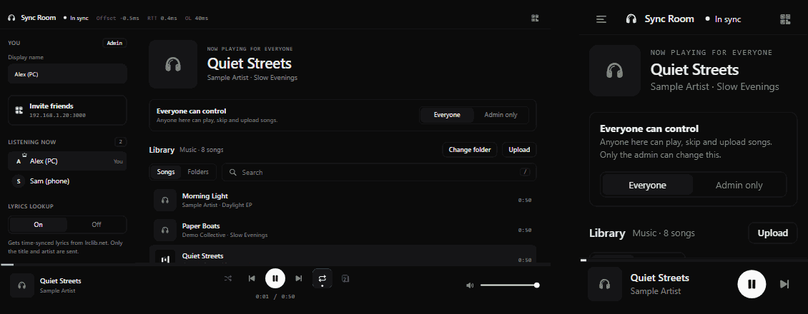
</p>

- [What you get](#what-you-get)
- [Quick start](#quick-start)
- [Connect friends and phones](#connect-friends-and-phones)
- [Admin and guests](#admin-and-guests)
- [Your music: folders, search, upload](#your-music-folders-search-upload)
- [Playing songs](#playing-songs)
- [Lyrics](#lyrics)
- [How the sync works](#how-the-sync-works)
- [Privacy and security](#privacy-and-security)
- [Using it away from home](#using-it-away-from-home)
- [Configuration](#configuration)
- [Troubleshooting](#troubleshooting)
- [Support](#support)
- [Project layout](#project-layout)
- [Credits and license](#credits-and-license)

---

## What you get

| | |
|---|---|
| **Synchronised playback** | Every device schedules the same audio against a shared clock. Pause, seek or skip on one device and all of them follow. |
| **Your files, your folder** | Songs are streamed from a folder on the host computer. Pick any folder in the app; subfolders are included. |
| **Join with a QR code** | Friends scan, tap **Start listening**, and they are in. No password and nothing to install. |
| **Songs and Folders views** | Browse like a phone music player, or search by title, artist or album. Real titles, artists, albums and cover art come from the files' own tags. |
| **Time-synced lyrics** | Lines highlight and scroll with the music on every device. Optional, and easy to switch off. |
| **You are the admin** | Whoever runs it on the host computer is the admin, with no password. One switch decides whether friends may also control playback and upload. |
| **Made for phones too** | A compact player bar that opens into a full "Now playing" screen. |
| **No third parties** | No CDN, no fonts, no analytics, no tracking. The only optional outside request is the lyrics lookup. |

<p align="center">
  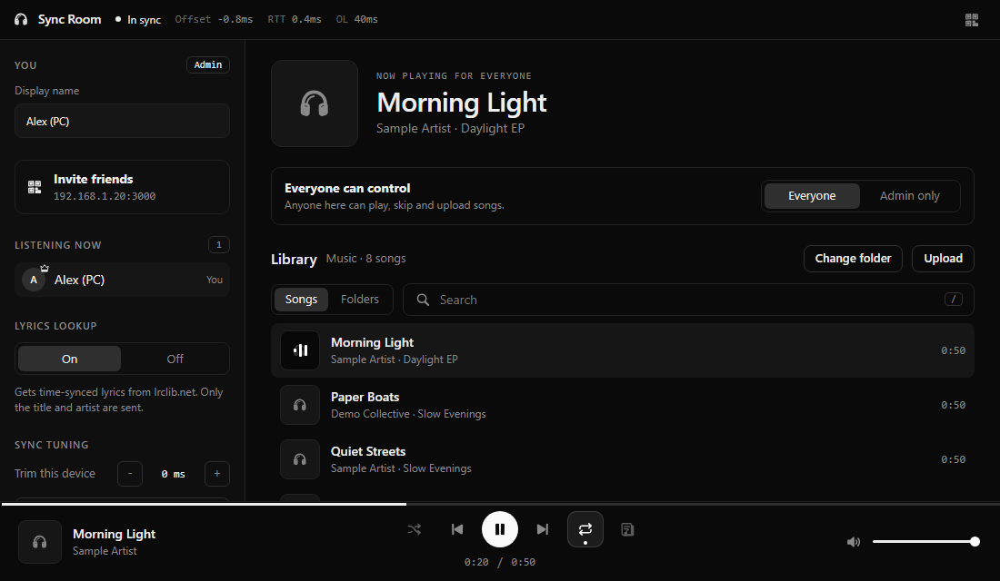
</p>

---

## Quick start

To run from source you need **[Node.js](https://nodejs.org) 22 or newer** (the current LTS is fine) on the computer that will host the music; the Windows portable download does not need it. The host can be Windows, macOS or Linux. Friends need only a modern browser.

### Easiest on Windows: the portable download

1. Download **`sync-room-v1.0.0-windows-portable.zip`** from the [latest release](../../releases/latest).
2. Unzip it anywhere (a USB stick works too) and double-click **`start.bat`**.

Node.js and every dependency are **included**, so there is nothing to install. Your settings and lyrics cache stay inside that folder, so you can move or delete the whole folder freely. Then follow "Connect friends and phones" below. If you would rather run from source, use the steps below.
### Windows (from source)

1. Install Node.js from [nodejs.org](https://nodejs.org).
2. Download or clone this repository.
3. Double-click **`start.bat`**. The first run installs the dependencies and creates `config.json`.
4. Allow **Private networks** when the Windows Firewall asks, so your phone can reach the PC.
5. Open **<http://localhost:3000>** on that PC. Opening it as `localhost` is what makes you the admin.
6. Tap **Start listening** once (browsers need one tap before they allow sound).

### macOS / Linux

```bash
git clone https://github.com/jrayaz/sync-room.git
cd sync-room
npm install --omit=dev
node server.js          # or: npm start
```

Prefer a double-click? Run `chmod +x start.command` once, then double-click **`start.command`**. macOS may ask whether to allow incoming connections: allow it so friends can join. Then open <http://localhost:3000>.

### Choose your music

Click **Change folder** above the library, browse to the folder that holds your songs (or paste its path), and press **Use this folder**. The choice is remembered. Details in [Your music](#your-music-folders-search-upload).

The terminal window prints the addresses to use:

```
This PC:   http://localhost:3000        <- open this one (you are the admin)
Wi-Fi/LAN: http://192.168.x.x:3000      <- friends use this, or scan the QR code in the app
```

---

## Connect friends and phones

Friends must be on **the same Wi-Fi** as the host computer. There is nothing to install and no account to create.

<p align="center">
  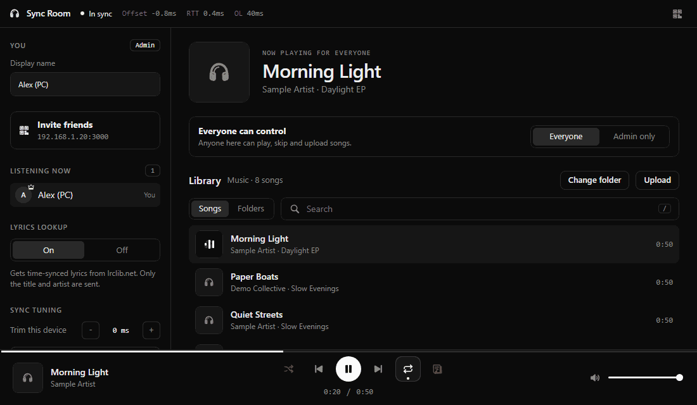
</p>

1. On the host, click the **QR icon** in the top bar (or **Invite friends** in the sidebar). A large QR code and the link appear. Click the link to copy it.
2. On a phone, scan the QR code with the camera (or type the link into the browser).
3. The page calibrates the phone's clock for a moment, then shows **Start listening**. Tap it.
4. That's it. The phone drops in at the right place in the song.

<p align="center">
  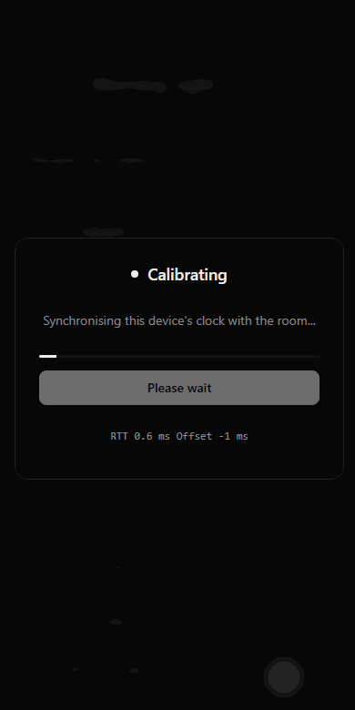
</p>

<p align="center">
  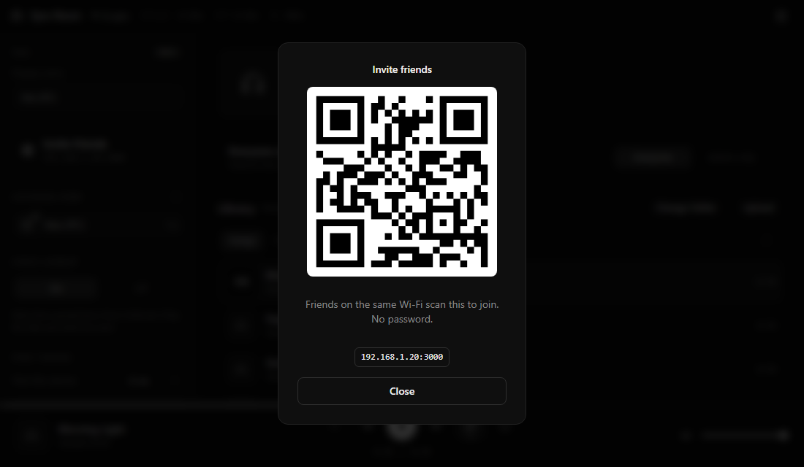
</p>

**Good to know**

- **Android Chrome may show "Not secure" next to the address.** That is normal for a plain `http://` link on your home network. Nothing is sent over the internet, and audio works fine.
- **iPhone and Mac Safari work too.** Safari cannot report the phone's exact speaker delay, so use **Trim** (below) if one device sounds slightly early or late.
- Friends can rename themselves in the sidebar. The sidebar lists everyone listening; with more than five people it shows five and a **Show all** arrow.
- **How many people?** There is no built-in limit. The practical limit is your Wi-Fi: each device downloads the whole song when it changes (a FLAC is roughly 20 to 30 MB). Around **10 to 15 people** is comfortable on a normal home router.

---

## Admin and guests

There are no passwords and no accounts. The role is decided by *where the request comes from*:

| | **Admin** (the host computer) | **Guest** (everyone else) |
|---|---|---|
| Listen, rename themselves, use the lyrics, trim their own device | yes | yes |
| Play, pause, seek, skip, shuffle, repeat | yes | only when the access switch is **Everyone** |
| Upload songs | yes | only when the access switch is **Everyone** |
| Delete songs, change the music folder, change the access switch, turn lyrics lookup on or off | yes | no |

The **access switch** sits near the top of the main screen: **Everyone** or **Admin only**. It controls playback and uploading together, so there is one simple rule to understand.

A request counts as **admin** only if it:

- comes from the very computer running the server,
- is addressed to a name that computer owns (`localhost`, its own IP addresses, or its host name),
- carries no proxy or tunnel headers, and
- comes from this app's own page.

Everything else is a guest. The last rule also stops other websites open in your browser from controlling the server.

> **Tip:** on the host computer, open the app as `http://localhost:3000` (or its Wi-Fi address). Opening it through a tunnel or a Tailscale name makes that session a guest.

---

## Your music: folders, search, upload

<p align="center">
  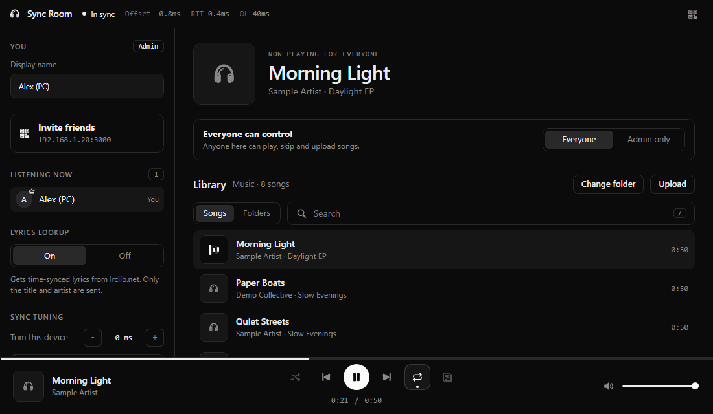
</p>

### Choosing the folder (admin)

**Change folder** opens a folder browser for the host computer.

- Click folders to move in, use the back arrow to go up, then press **Use this folder**.
- **Or paste a path** (for example `D:\Music` or `/Users/me/Music`) into the box and press **Enter** or **Go**. Windows' "Copy as path" quotes are handled.
- Shortcuts are listed for Music, Downloads, Documents and Desktop, plus `/Volumes` on macOS.
- Subfolders are scanned too, up to 3000 songs.
- The folder you choose is saved in `config.json`. Only the host computer can browse or change folders, and guests never see your folder paths.

<p align="center">
  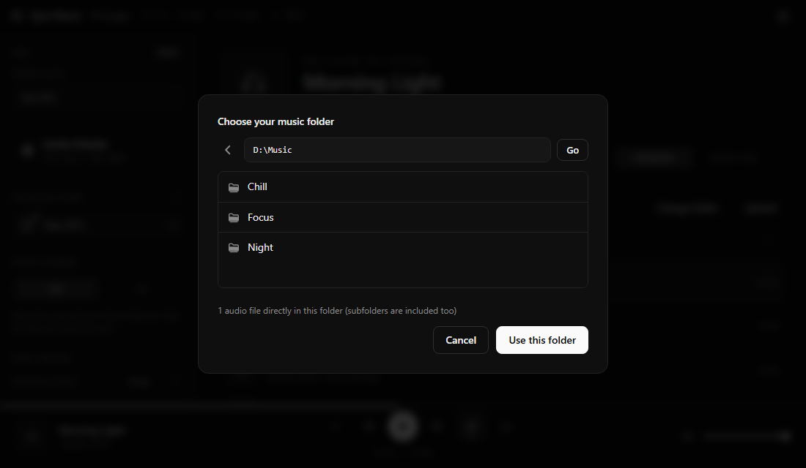
</p>

### Browsing and searching

- **Songs** shows everything in one list. **Folders** lists each folder with its song count; open one to see just its songs, and use the back arrow to return. Next and Previous stay inside the folder you started from.
- **Search** (press **/** to focus it) filters by title, artist and album.
- Click the **now-playing area** at the bottom (or the big card at the top) to jump to the playing song in the list.
- Titles, artists, albums and cover art are read from the files' own tags (MP3, FLAC, M4A, and more). Files without tags use their file name.
- Supported formats: `mp3`, `m4a`, `aac`, `wav`, `ogg`, `opus`, `flac`, `webm`.

### Upload and delete

- **Upload** (or drag and drop files onto the page) saves songs into the current music folder, up to 300 MB each. Guests can upload only when the access switch is **Everyone**.
- The admin sees a small **✕** when hovering a song on a computer. It deletes the file from the host computer after a confirmation.

---

## Playing songs

<p align="center">
  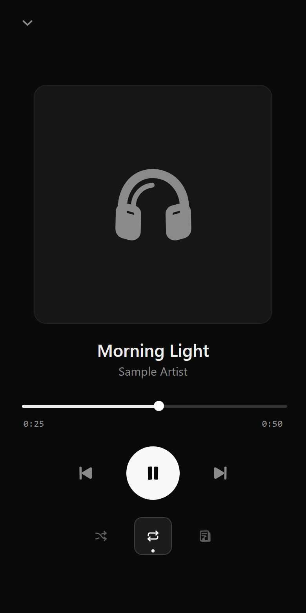
</p>

| Control | What it does |
|---|---|
| **Progress line** (very top edge of the player bar) | Shows position; click or drag to seek. It thickens when you hover it. |
| **Play / Pause, Previous, Next** | Shared by everyone in the room. Previous restarts the song if it has been playing for more than 3 seconds. |
| **Shuffle** and **Repeat** | A bright icon in a framed box with a dot underneath means **on**; a dim plain icon means **off**. Repeat cycles off, all, and one song. |
| **Lyrics** | Opens the lyrics view (only shown when lyrics lookup is on). |
| **Volume** and **Trim** | Per device, remembered for next time. |

**On phones** the player is a slim bar with the cover, title and play/next. Tap it for the full "Now playing" screen. Close it with the arrow, by swiping down, or with the Android back button.

**Keyboard shortcuts** (on a computer): `Space` play or pause, `N` next, `P` previous, `L` lyrics, `/` search, `Esc` close.

Shuffle, repeat, the current song and its position are **shared**: when one person turns shuffle on, everyone sees it on. The status bar at the top shows this device's clock `Offset`, round-trip time `RTT`, and speaker delay `OL`.

---

## Lyrics

<p align="center">
  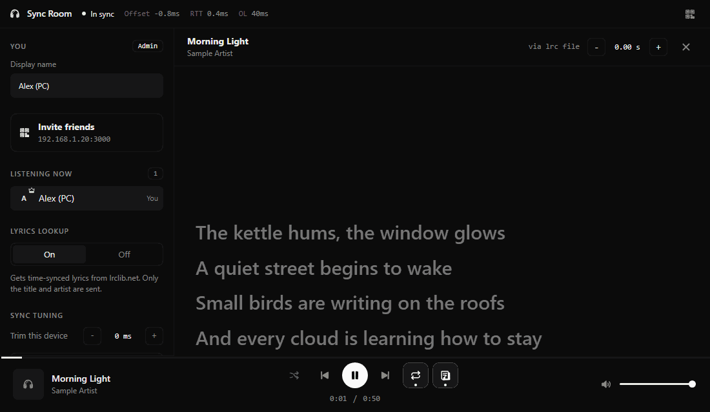
</p>

Press the lyrics button (or **L**) to open a clean lyrics view. The current line is bright, past lines fade, and it scrolls by itself. Tap a line to jump there (if you are allowed to control playback). If you scroll by hand, auto-scroll pauses for a few seconds. A small **- / +** control shifts the timing in 0.25-second steps on that device.

**Where lyrics come from, in order:**

1. A **`.lrc` file** with the same name next to the song (for example `Song.flac` and `Song.lrc`). Always checked first, and you can write your own.
2. **[LRCLIB](https://lrclib.net)**, a free, community-run lyrics database with no account or API key. Used only when **Lyrics lookup** is **On**.

Only **time-synced** lyrics are shown. If a song has none, you see "No lyrics found" instead of a block of text that cannot follow the music.

**Privacy:** the lookup runs on the **host computer only**; friends' devices never contact LRCLIB. It sends only the song's **title and artist** (plus album and length to match the right version), never audio and never your files. Each result is cached in `lyrics-cache.json` on the host, so a song is looked up at most once. Turn **Lyrics lookup** **Off** in the sidebar and nothing is ever sent; the lyrics button disappears. Coverage is best for popular songs; regional and older songs are often missing.

<p align="center">
  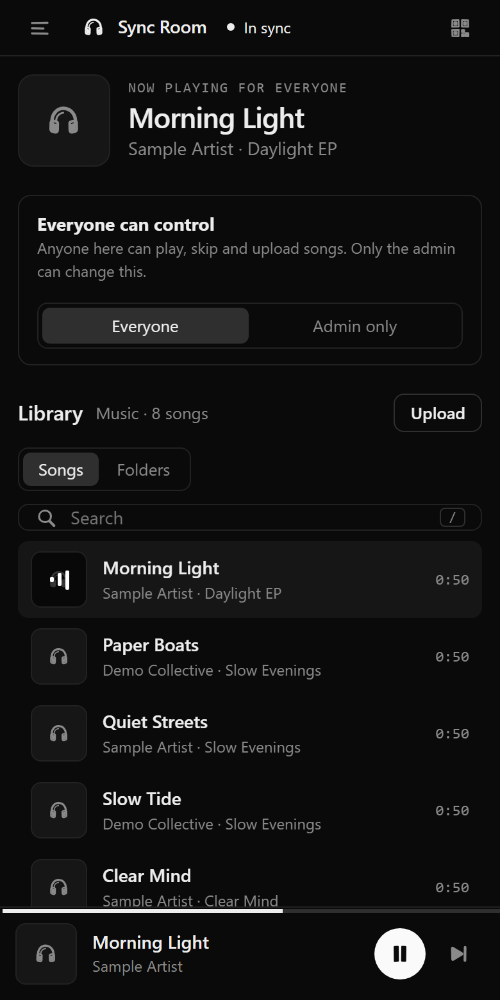
</p>

---

## How the sync works

Getting several devices to play the same audio at the same instant takes three things:

1. **A shared clock.** When a device connects it pings the host about 16 times, measures each round trip, and estimates how far its own clock is from the host's. It keeps the fastest quarter of the measurements (the ones with the least network jitter) and uses their median. It keeps re-measuring every few seconds.
2. **Scheduling, not "play now".** The host keeps one playback state: which song, and "position X at host-time T". Play and seek take effect about 0.7 seconds in the future, so every device has time to receive the message and line up. Each device then starts its audio with the Web Audio API at the exact moment its clock says it should, compensating for its own speaker delay. Late joiners work out the correct position the same way.
3. **Drift correction.** Once a second each device compares what it is playing with where the shared clock says it should be. If it has wandered more than about 25 ms, it re-aims itself.

**Tips for the tightest sync**

- Use **each device's own speaker or a wire**. Bluetooth speakers and headphones add a delay (often 100 to 300 ms) that no web page can measure.
- If one device still sounds a little early or late, open the sidebar, find **Sync tuning**, and nudge **Trim** (5 ms steps, remembered per device) until it lines up by ear. **Re-sync clock** redoes the measurement if the network was busy.
- Keep devices on the same Wi-Fi band and close to the router; keep the page open (some phones pause audio when the screen locks, and the app then offers a one-tap **Rejoin**).
- Each song is decoded in the browser for sample-accurate timing, which uses roughly 100 MB of memory per 5 minutes of audio. Only the current and next song are kept.

<p align="center">
  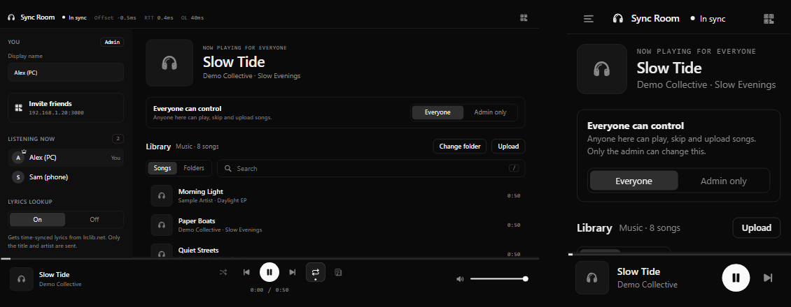
</p>

---

## Privacy and security

**Your music stays on your computer.** Songs are streamed from the chosen folder to the devices in the room, over your own network. They are never uploaded to any service.

- **No third-party requests.** The page loads its own files only: no CDN, no web fonts, no analytics, no trackers. The QR code is generated on the host. A strict Content-Security-Policy enforces this in the browser.
- **The one optional outside request** is the lyrics lookup to `lrclib.net`, made by the host only and described above. Turn it off and the app makes no outside connections at all.
- **Only files in the chosen folder can be streamed**, and only audio files that the library lists. The folder browser exists only for the host computer; guests cannot list or open other folders.
- **Keep it on your network.** Anyone who can reach the link can join as a guest, so use it on your home Wi-Fi or a private network like Tailscale. **Do not port-forward it or expose it through a public tunnel.**
- Requests from other websites are rejected (origin and host checks), so a web page open in your browser cannot control your server.
- `config.json`, `lyrics-cache.json`, `music/` and `node_modules/` are in `.gitignore`, so your folder path and songs are never pushed to GitHub.
- Please only use music you own or have the right to play. Lyrics from LRCLIB are community-submitted and are only displayed, never stored for sharing.

---

## Using it away from home

For friends who are not on your Wi-Fi, use a private network such as **[Tailscale](https://tailscale.com)**:

1. Install Tailscale on the host computer and on each friend's device, signed in to the same tailnet.
2. Friends open `http://<host-name>:3000`.
3. Traffic is encrypted between your own devices and nothing is public. The QR code adapts to the address you opened.

Keep using `http://localhost:3000` on the host itself to stay admin.

---

## Configuration

`config.json` is created on first run. You rarely need to edit it.

| Key | Default | Meaning |
|---|---|---|
| `port` | `3000` | The port the server listens on. The `PORT` environment variable overrides it for one run. |
| `musicDir` | `"music"` | The music folder. Normally set from the app with **Change folder**. |
| `maxUploadMB` | `300` | Largest single upload. |
| `lyricsOnline` | `true` | Whether the host may look up lyrics on lrclib.net. Normally set from the app. |

Other files the app creates on the host: `lyrics-cache.json` (cached lyric results). Both are in `.gitignore`.

---

## Troubleshooting

**A friend's phone cannot open the link.**
- Is the phone on the *same Wi-Fi* as the host computer (not mobile data, not a "guest" network)? Some routers isolate guest networks from the main one ("AP isolation").
- Did you allow the app through the firewall? On Windows, allow **Private networks**; on macOS, allow incoming connections.
- Is the server window still open and running?
- Use the exact Wi-Fi address from the QR popup or the terminal, with the port.

**I see "Calibrating" for a long time.** The phone is measuring its clock. If it never finishes, the connection is probably being blocked or is very unstable. Move closer to the router and reload the page.

**Everything is silent until I tap.** Browsers require one tap before they allow sound. Tap **Start listening** (or **Rejoin**). This is a browser rule, not a bug.

**One device is a little early or late.** Use the device's own speaker or a wire, then adjust **Trim** in the sidebar. Bluetooth cannot be measured automatically.

**Songs take a while to start after skipping.** Every device downloads the whole song when it changes. Large FLAC files on a busy Wi-Fi take longer; the next song is preloaded to hide this. Fewer devices, a closer router or smaller files help.

**I don't see Change folder, Upload or delete buttons.** Those are admin tools. Open the app as `http://localhost:3000` on the host computer. Delete is hidden on touch screens on purpose. Upload shows for guests only when the access switch is **Everyone**.

**"Only the admin can control playback right now".** The admin set the access switch to **Admin only**. Ask them to switch it to **Everyone**.

**No lyrics for a song.** Only time-synced lyrics are shown. Check that **Lyrics lookup** is **On**, that the host has internet, and that the song's title and artist are right (the tags are used for matching). You can always add your own `.lrc` file next to the song.

**My changes to `config.json` were ignored.** Edit it while the server is stopped, then start it again. Make sure it is valid JSON.

**The server says the port is in use.** Another program (or another copy of Sync Room) is using port 3000. Close it, or run with a different port: `PORT=3001 node server.js` (macOS/Linux) or `set PORT=3001 && node server.js` (Windows Command Prompt).

---

## Support

Found a bug or have an idea? Please [open an issue](../../issues). To help us help you, include:

- your host operating system and Node.js version (`node -v`),
- the browser and device that had the problem (for example "Chrome on Android 14"),
- what you expected and what happened, with a screenshot if you can,
- the `Offset`, `RTT` and `OL` values from the status bar if it is a sync problem.

Please do not post your `config.json` or music file names if they are private.

---

## Project layout

```
sync-room/
├─ server.js          web server, admin/guest rules, folder browser, library scan + tags,
│                     audio streaming, lyrics, shared playback state, QR, clock replies
├─ public/
│  ├─ index.html      the page
│  ├─ style.css       the (minimal, black-and-white) look
│  └─ app.js          clock sync, audio engine, library, lyrics, player
├─ start.bat          Windows launcher
├─ start.command      macOS / Linux launcher
├─ docs/              the screenshots and GIFs used in this README
├─ music/             default music folder (optional)
└─ config.json        created on first run (not committed)
```

It is a small Node.js app with three runtime dependencies: [`ws`](https://github.com/websockets/ws) (WebSockets), [`music-metadata`](https://github.com/Borewit/music-metadata) (reading tags and cover art) and [`qrcode-generator`](https://github.com/kazuhikoarase/qrcode-generator) (the invite QR code). The page itself is plain HTML, CSS and JavaScript with no build step.

---

## Credits and license

- The idea of a synchronised listening room was inspired by [Beatsync](https://github.com/freeman-jiang/beatsync). Sync Room is an independent, self-hosted take on it that keeps your files on your own machine.
- Lyrics come from the community-run [LRCLIB](https://lrclib.net).
- The demo songs and lyrics in the screenshots and GIFs are generated tones and made-up text created for this README.
- The Windows portable download bundles an unmodified [Node.js](https://nodejs.org) runtime (MIT license; its license text is in 
untime/LICENSE-node.txt).

**License:** [MIT](LICENSE).
